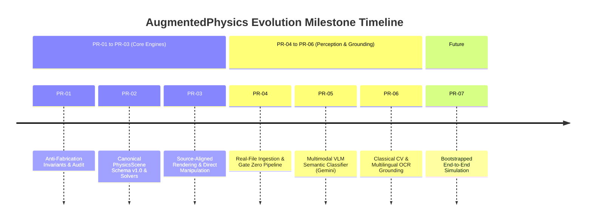
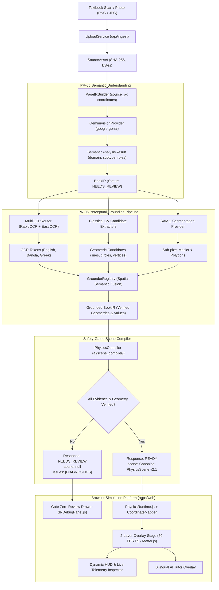

# AugmentedPhysics v2 — Comprehensive System Documentation & Technical Progress Report

**Repository:** [rahi-sadat/AI-Enhanced-Interactive-Physics-Textbook](https://github.com/rahi-sadat/AI-Enhanced-Interactive-Physics-Textbook)  
**Project:** AugmentedPhysics v2 (AI-Enhanced Interactive Physics Textbook & Simulation Platform)  
**Scope:** Complete history, architectural foundations, milestone evolution (PR-01 through PR-06), mathematical solvers, perception pipelines, and current verification state.  
**Date:** October 2026  
**Status:** PR-01 through PR-06 Merged to `main` (`849cc1b`) | All Tests Passing (116 Python / 241 Frontend)

---

## Table of Contents

1. [Executive Summary & Core Scientific Mission](#1-executive-summary--core-scientific-mission)
2. [Foundational Research Paradigm & The Anti-Fabrication Invariant](#2-foundational-research-paradigm--the-anti-fabrication-invariant)
3. [Chronological Milestone Progression (PR-01 through PR-06)](#3-chronological-milestone-progression-pr-01-through-pr-06)
   - [PR-01: Strict Audit & Anti-Fabrication Invariants](#pr-01-strict-audit--anti-fabrication-invariants)
   - [PR-02: Canonical PhysicsScene Schema v1.0 & PhysicsRuntime](#pr-02-canonical-physicsscene-schema-v10--physicsruntime)
   - [PR-03: Source-Aligned Rendering & Bidirectional Manipulation](#pr-03-source-aligned-rendering--bidirectional-manipulation)
   - [PR-04: Real-File Ingestion & Gate Zero Invariant](#pr-04-real-file-ingestion--gate-zero-invariant)
   - [PR-05: Multimodal VLM Semantic Understanding (Gemini)](#pr-05-multimodal-vlm-semantic-understanding-gemini)
   - [PR-06: Classical CV + Multilingual OCR Parameter Grounding](#pr-06-classical-cv--multilingual-ocr-parameter-grounding)
4. [High-Level System Architecture](#4-high-level-system-architecture)
5. [Data Contracts & Canonical Intermediate Representations (IR)](#5-data-contracts--canonical-intermediate-representations-ir)
   - [SourceAsset $\to$ PageIR $\to$ BookIR $\to$ Grounded BookIR $\to$ PhysicsScene](#ir-data-flow)
   - [The Strict Status Invariant Hierarchy](#the-strict-status-invariant-hierarchy)
6. [Multi-Domain Physics Engines & Mathematical Solvers](#6-multi-domain-physics-engines--mathematical-solvers)
   - [Mechanics & Kinematics Engine (RK4 & Matter.js)](#mechanics--kinematics-engine)
   - [Geometric Optics Engine (Analytical Vector Ray-Tracing)](#geometric-optics-engine)
   - [Circuits Laboratory (Browser-Native Float64 MNA Solver)](#circuits-laboratory)
7. [Computer Vision, OCR & Evidence Grounding Pipelines (PR-06 Deep Dive)](#7-computer-vision-ocr--evidence-grounding-pipelines-pr-06-deep-dive)
   - [Deterministic Classical CV Geometry Extractors](#deterministic-classical-cv-geometry-extractors)
   - [Multilingual OCR Router (RapidOCR + EasyOCR for English & Bangla)](#multilingual-ocr-router)
   - [SAM 2 (Segment Anything 2) Mask Provider](#sam-2-segment-anything-2-mask-provider)
   - [Spatial-Semantic Grounding & Parameter Association](#spatial-semantic-grounding--parameter-association)
8. [Frontend Simulation Architecture & Interactivity](#8-frontend-simulation-architecture--interactivity)
   - [Sub-Pixel 2-Layer Stage Alignment & CoordinateMapper](#sub-pixel-2-layer-stage-alignment--coordinatemapper)
   - [Common Runtime `<InteractiveFigure>` vs Legacy Studio](#common-runtime-interactivefigure-vs-legacy-studio)
   - [Bidirectional Direct Manipulation & Telemetry](#bidirectional-direct-manipulation--telemetry)
   - [Grounded Bilingual AI Tutor Bridge](#grounded-bilingual-ai-tutor-bridge)
9. [Testing, Verification & Quality Assurance Matrix](#9-testing-verification--quality-assurance-matrix)
10. [Future Roadmap: PR-07 & Beyond](#10-future-roadmap-pr-07--beyond)

---

## 1. Executive Summary & Core Scientific Mission

Static textbook diagrams are the primary visual medium for secondary and higher secondary physics education worldwide. However, static drawings cannot convey dynamics, temporal evolution, parameter sensitivities, or counterfactual reasoning (e.g., *"What happens if the refractive index increases?"* or *"What happens if resistor $R_2$ is removed?"*).

**AugmentedPhysics v2** solves this by converting static printed textbook diagrams into **embedded, interactive, 2D simulation laboratories**. Rather than discarding the authentic textbook diagram and replacing it with an artificial vector graphic, AugmentedPhysics superimposes a high-performance 60 FPS interactive physics overlay directly onto the printed diagram with **sub-pixel registration**.

### Core Platform Pillars:
1. **Book-Agnostic Architecture**: While demonstrated using National Curriculum and Textbook Board (NCTB) Bangladesh physics curricula (English and Bangla text), the underlying schemas, solvers, and perception pipelines are strictly book-neutral.
2. **Multi-Domain Breadth**: Seamlessly supports three foundational branches of classical physics:
   - **Kinematics & Mechanics** (Simple Pendulums, Projectiles, Newton's Cradle, Incline Ramps).
   - **Geometric Optics** (Thin Convex/Concave Lenses, Snell's Law Refraction, Critical Angle/TIR, Prisms, Spherical/Plane Mirrors).
   - **Linear DC Circuits** (Resistor Networks, Voltage Dividers, Diamond Wheatstone Bridge, SPICE-validated MNA).
3. **Truthful, Non-Fabricating AI**: Unlike generic generative models that fabricate missing parameters or hallucinate coordinates, AugmentedPhysics enforces strict provenance tracking and non-fabrication invariants at every pipeline boundary.

---

## 2. Foundational Research Paradigm & The Anti-Fabrication Invariant

The project is grounded in the paradigm established by:
> **"Augmented Physics: Creating Interactive and Embedded Physics Simulations from Static Textbook Diagrams"**  
> *ACM UIST '24 — Gunturu et al.*

### The Trap of Simulation Fabrication
In early prototypes and naive implementations, physics simulation synthesis suffered from severe systemic shortcuts:
- **Heuristic File-Name Sniffing**: A file named `lens.png` would trigger a lens simulation simply based on its filename string, ignoring image contents.
- **Silent Parameter Guessing**: If a diagram did not show gravity or mass, systems would quietly insert $g = 9.81\,\text{m/s}^2$ or $m = 1\,\text{kg}$ and run the simulation.
- **Hallucinated Coordinates**: Generative models would guess arbitrary canvas positions ($x=200, y=300$).
- **The Landscape Photo Fallback**: Uploading a photo of a cat or mountain would erroneously synthesize a swinging pendulum because the system forced a simulation to run at all costs.

### The Non-Negotiable Core Principle: Gate Zero Anti-Fabrication Invariant
> *"An interactive physics simulation must be grounded in verified perceptual evidence. Missing evidence must produce an honest review request (`NEEDS_REVIEW` with `scene: null`), NEVER a fabricated running simulation."*

This invariant is programmatically guaranteed:
- If a diagram lacks explicit numerical values or detected geometry, the compiler halts cleanly.
- `scene` is guaranteed to be `null` unless the status is strictly `READY`.
- The user is presented with a diagnostic inspection drawer detailing exactly what evidence is missing or requires manual confirmation.

---

## 3. Chronological Milestone Progression (PR-01 through PR-06)



### PR-01: Strict Audit & Anti-Fabrication Invariants
- **Goal**: Cleanse the codebase of heuristic shortcuts, synthetic fallbacks, and parameter guessing.
- **Accomplishments**:
  - Eliminated all automatic routing based on image filenames or URL strings.
  - Implemented the envelope contract: status `ready` requires a valid non-null `scene`; status `needs_review`, `unsupported`, or `unresolved` must enforce `scene: null`.
  - Added negative-path tests verifying that non-physics images or missing parameters never yield executable physics scenes.

### PR-02: Canonical PhysicsScene Schema v1.0 & PhysicsRuntime
- **Goal**: Create a unified, framework-agnostic data contract separating perception from simulation execution.
- **Accomplishments**:
  - Created canonical schema `PhysicsScene` (v1.0 / v2.1) in [`shared/schemas/`](file:///d:/AugmentedPhysics/shared/schemas/).
  - Standardized coordinate transformations across three discrete coordinate spaces:
    1. `source_px`: Pixel coordinates native to the scanned textbook diagram.
    2. `view_px`: Scaled, letterbox-compensated viewport coordinates in the browser.
    3. `world_m`: Physical SI units (meters, seconds, kilograms) used by mathematical solvers.
  - Developed `PhysicsRuntime.js` and `SolverRegistry` in [`engine/core/`](file:///d:/AugmentedPhysics/engine/core/) supporting pluggable domain engines.

### PR-03: Source-Aligned Rendering & Bidirectional Manipulation
- **Goal**: Enable students to manipulate simulations directly on top of the original textbook diagram.
- **Accomplishments**:
  - Developed `RendererRegistry` and `SimulationCapabilityRegistry`.
  - Built direct-manipulation drag handles on the canvas for dynamic elements (e.g., optical arrow objects, pendulum bobs, circuit switches).
  - Implemented bidirectional synchronization: dragging a physical element on canvas updates HUD numerical readouts; adjusting a HUD slider moves the canvas element.
  - Sub-pixel alignment: overlaying rays and vectors exactly on top of textbook lines.

### PR-04: Real-File Ingestion & Gate Zero Invariant
- **Goal**: Transition from static JSON fixtures to accepting real image files uploaded by users.
- **Accomplishments**:
  - Engineered `UploadService` handling streaming multipart uploads up to 50 MB with cryptographic SHA-256 fingerprinting.
  - Introduced canonical Intermediate Representations: `SourceAsset` $\to$ `PageIR` $\to$ `BookIR`.
  - Developed the **Gate Zero UI**: when an uploaded diagram is evaluated, if evidence is incomplete, the system displays honest review badges and diagnostic metadata rather than crashing or faking physics.

### PR-05: Multimodal VLM Semantic Understanding (Gemini)
- **Goal**: Integrate foundation Vision-Language Models to semantically understand textbook pages.
- **Accomplishments**:
  - Integrated Google Gemini via the official `google-genai` SDK (`GeminiVisionProvider`).
  - **Strict Semantic Boundary**: The VLM operates strictly as a semantic classifier:
    - Allowed: `classification`, `isPhysics`, `domain`, `subtype`, and coarse taxonomy with bounding boxes quarantined in `vlmApproxBBox`.
    - Prohibited: Generating physical constants ($g, m, f, R$) or authoritative coordinates.
  - **Conservative Confidence Policy**: Reserved $1.0$ strictly for ground truth. VLM confidence is capped below $1.0$, and overall score is hierarchically defined:
    $$\text{confidence}_{\text{overall}} = \min(\text{isPhysics}, \text{domain}, \text{subtype})$$
  - **Async Event Loop Offloading**: Heavy synchronous external HTTP calls offloaded via `await asyncio.to_thread(...)`.

### PR-06: Classical CV + Multilingual OCR Parameter Grounding (Current State)
- **Goal**: Extract deterministic physical geometry and read printed multilingual values (English & Bangla) to bind numbers to visual entities without hallucination.
- **Accomplishments**:
  - **Classical CV Extractors**: Domain-specific CV algorithms for pendulums, projectiles, lenses, mirrors, refraction boundaries, prisms, and circuits.
  - **Multilingual OCR Router**: `MultiOCRRouter` coupling RapidOCR (ONNX Runtime) with EasyOCR, supporting English digits, Greek physics symbols ($\theta, \lambda, \Omega, \mu, \Sigma$), and Bengali numerals/words (`১০ ওহম`, `২০ সে.মি.`).
  - **SAM 2 Provider**: Meta Segment Anything Model 2 integration (`SAM2SegmentationProvider`) for zero-shot boundary and mask extraction.
  - **Typed Evidence Registry**: Structured models in [`shared/schemas/evidence.py`](file:///d:/AugmentedPhysics/shared/schemas/evidence.py) representing tokens, candidates, and spatial-semantic parameter binding.

---

## 4. High-Level System Architecture

The following diagram illustrates the complete end-to-end data pipeline from an uploaded textbook scan to the browser-based simulation overlay:



---

## 5. Data Contracts & Canonical Intermediate Representations (IR)

### IR Data Flow

```
Raw Bytes ──► SourceAsset ──► PageIR ──► BookIR ──► Grounded BookIR ──► PhysicsScene
 (Disk)       (SHA-256)     (source_px)  (Semantics)  (CV + OCR + SAM2)  (Simulation)
```

1. **`SourceAsset`** ([`shared/schemas/ingestion.py`](file:///d:/AugmentedPhysics/shared/schemas/ingestion.py)):
   - Represents the raw uploaded file on disk.
   - Key attributes: `id`, `storage_path`, `sha256`, `mime_type`, `width_px`, `height_px`.
   - Security guarantee: SHA-256 hash guarantees file identity; filenames are treated as metadata only.

2. **`PageIR`**:
   - Represents the document structure and figure regions in natural `source_px`.
   - Normalizes coordinates so bounding boxes directly map to image pixel space.

3. **`BookIR`**:
   - Represents the semantic model of the physics figure.
   - Contains: `domain`, `subtype`, `entities`, `relationships`, `parameters`, `confidence`.
   - In PR-05, all VLM-inferred entities have ungrounded coordinates (`position_source_px = None`) and approximate bounding boxes isolated in `attributes["vlmApproxBBox"]`.

4. **`Grounded BookIR`** (PR-06):
   - Augments `BookIR` with classical CV candidate geometry, verified OCR text tokens, and spatial-semantic parameter associations.

5. **`PhysicsScene`** ([`shared/schemas/`](file:///d:/AugmentedPhysics/shared/schemas/)):
   - The canonical simulation contract consumed by frontend engines.
   - Contains elements, parameters, coordinate transformation metadata, and rendering instructions.

### The Strict Status Invariant Hierarchy

The pipeline enforces four strictly validated execution statuses:

| Status | Scene Value | Description |
| :--- | :--- | :--- |
| **`READY`** | `dict` (Non-null) | All required parameters and geometry are completely verified. Runnable. |
| **`NEEDS_REVIEW`** | `null` | Figure recognized as supported physics, but values or geometry need verification. |
| **`UNSUPPORTED`** | `null` | Figure recognized as physics, but subtype is not yet implemented in solvers. |
| **`UNRESOLVED`** | `null` | Non-physics image, corrupted diagram, or unclassifiable figure. |

---

## 6. Multi-Domain Physics Engines & Mathematical Solvers

AugmentedPhysics v2 integrates three specialized, framework-agnostic mathematical engines in [`engine/`](file:///d:/AugmentedPhysics/engine/):

### Mechanics & Kinematics Engine
- **Runge-Kutta 4 (RK4) Pendulum Solver**:
  - Solves the nonlinear differential equation for large-angle oscillations without small-angle approximation:
    $$\frac{d^2\theta}{dt^2} + \frac{b}{m}\frac{d\theta}{dt} + \frac{g}{L}\sin(\theta) = 0$$
  - Real-time numerical integration computes angular velocity $\omega(t)$ and angular position $\theta(t)$ with sub-pixel string tension vector rendering.
- **Matter.js 2D Rigid Body Engine**:
  - Handles contact dynamics, restitution, coefficient of friction, ramp collisions, and Newton's Cradle 5-bob momentum transfer.

### Geometric Optics Engine
- **Thin Lens Analytical Engine**:
  - Implements the Gaussian thin lens equation:
    $$\frac{1}{f} = \frac{1}{u} + \frac{1}{v}, \quad m = -\frac{v}{u}$$
  - Traces principal rays (parallel ray through focal point, central ray through optical center, focal ray emerging parallel) for convex and concave lenses.
- **Vector Snell's Law & Total Internal Reflection (TIR)**:
  - Vector formulation of Snell's Law at planar interfaces:
    $$n_1 (\vec{d} \times \vec{n}) = n_2 (\vec{r} \times \vec{n})$$
  - Analytical computation of the critical angle $\theta_c = \arcsin(n_2 / n_1)$. If incident angle $\theta_i > \theta_c$, the engine automatically transitions from refraction to total internal reflection.
- **Prism Ray Deviation Engine**:
  - Computes minimum deviation $\delta$ across triangular glass prisms:
    $$n = \frac{\sin\left(\frac{A + \delta_m}{2}\right)}{\sin\left(\frac{A}{2}\right)}$$
- **Spherical & Plane Mirrors**:
  - Traces reflections for concave and convex mirrors using mirror formula $\frac{1}{f} = \frac{1}{u} + \frac{1}{v}$ with radius of curvature $R = 2f$.

### Circuits Laboratory
- **Browser-Native Modified Nodal Analysis (MNA)**:
  - Solves complex DC linear circuits using matrix nodal formulation without third-party physics libraries:
    $$\mathbf{G} \mathbf{v} = \mathbf{i}$$
  - Implements LU Decomposition on typed `Float64Array` buffers for real-time (60 FPS) nodal voltage and branch current computation.
- **Circuit Topology & Wire Compilation**:
  - Employs Union-Find disjoint sets to reduce complex wire networks into canonical electrical nodes.
  - Computes polyline cumulative arc lengths to animate conventional electron flow particles at speeds proportional to branch current:
    $$v_{\text{particle}} \propto |I_{\text{branch}}|$$
- **SPICE Compatibility**:
  - Includes a Python backend SPICE netlist adapter ([`engine/circuits/spice_adapter.py`](file:///d:/AugmentedPhysics/engine/circuits/spice_adapter.py)) for ground-truth benchmark verification.

---

## 7. Computer Vision, OCR & Evidence Grounding Pipelines (PR-06 Deep Dive)

The newly integrated **PR-06 Evidence Pipeline** ([`ai/evidence/`](file:///d:/AugmentedPhysics/ai/evidence/)) bridges the gap between semantic understanding and executable physics.

```
Textbook Image ──┬──► Classical CV Extractors  ──► Geometric Candidates (lines, arcs, bobs)
                 ├──► MultiOCRRouter           ──► Text Tokens (values, units, symbols)
                 └──► SAM 2 Provider           ──► Exact Segmentation Masks
                                       │
                                       ▼
                       GrounderRegistry (Spatial-Semantic Fusion)
                                       │
                                       ▼
                             Grounded BookIR
```

### Deterministic Classical CV Geometry Extractors
Located in [`ai/evidence/cv/`](file:///d:/AugmentedPhysics/ai/evidence/cv/):
1. **`PendulumCVCandidateExtractor`**:
   - Uses adaptive thresholding, morphological opening, and Hough Circle Transforms to detect bobs.
   - Employs Hough Line / skeleton analysis to trace the suspension cord from pivot to bob center.
2. **`ThinLensCVCandidateExtractor`**:
   - Identifies the horizontal optical axis and vertical lens aperture line.
   - Refines optical center coordinates $(x_0, y_0)$ via sub-pixel intensity minimization.
3. **`InterfaceRefractionCVCandidateExtractor`**:
   - Detects the horizontal dielectric boundary line and vertical normal line.
   - Scans for incident and refracted ray segments to compute angles $\theta_1$ and $\theta_2$.
4. **`SphericalMirrorCVCandidateExtractor`**:
   - Uses vertical contour curvature analysis and circular least-squares fitting to calculate the pole and radius of curvature $R$.
5. **`PrismCVCandidateExtractor`**:
   - Detects triangular contours using Douglas-Peucker polygon approximation ($\epsilon = 0.04 \cdot \text{perimeter}$) to locate apex and base vertices.
6. **`CircuitCVCandidateExtractor`**:
   - Analyzes schematic wire topology, right-angle corners, loop junctions, and terminal lead locations.

### Multilingual OCR Router
Located in [`ai/evidence/ocr/`](file:///d:/AugmentedPhysics/ai/evidence/ocr/):
- **`RapidOCRProvider`**:
  - Powered by ONNX Runtime (`rapidocr` engine).
  - Fast, deterministic CPU inference on English characters, numbers, and decimals (`10 V`, `20 cm`, `5.0 kg`).
- **`BanglaOCRProvider`** (EasyOCR):
  - Specialized deep learning OCR for Bengali script.
  - Accurately transcribes Bengali numerals (`০, ১, ২, ৩, ৪, ৫, ৬, ৭, ৮, ৯`) and physics units (`১০ ওহম`, `১৫ সেমি`, `৪৫°`).
- **`GreekSymbolDetector`**:
  - Resolves confusable physics characters ($\theta, \lambda, \Omega, \mu, \Sigma$) that standard OCR engines misidentify as letters (`O`, `w`, `u`).

### SAM 2 (Segment Anything 2) Mask Provider
Located in [`ai/evidence/segmentation/`](file:///d:/AugmentedPhysics/ai/evidence/segmentation/):
- Integrates Meta's SAM 2 (`sam2.1_hiera_tiny.pt`).
- Accepts point prompts or bounding box priors from classical CV candidates to extract exact, sub-pixel object boundaries and alpha-transparent sprites.

### Spatial-Semantic Grounding & Parameter Association
Located in [`ai/evidence/grounding/`](file:///d:/AugmentedPhysics/ai/evidence/grounding/):
- **`PhysicalValueParser`**:
  - Parses raw OCR strings into typed numbers and standard SI units:
    - `"20 cm"` $\to$ `0.20 m`
    - `"10 kohm"` $\to$ `10,000 Ω`
    - `"45 deg"` $\to$ `45.0°`
- **`GrounderRegistry`**:
  - Performs spatial association between text tokens and geometric candidates using Euclidean bounding box proximity and ray projection.
  - Links an OCR token `"10 Ω"` to the nearest detected resistor candidate without guessing or fabricating coordinates.

---

## 8. Frontend Simulation Architecture & Interactivity

The frontend application in [`apps/web/`](file:///d:/AugmentedPhysics/apps/web/) is built with modern vanilla JavaScript and Vite, ensuring high responsiveness and zero heavy framework overhead.

```
┌────────────────────────────────────────────────────────┐
│                   apps/web/index.html                  │
├──────────────────────────┬─────────────────────────────┤
│ Platform Mode Bar        │ Figure Selector (1-4)       │
├──────────────────────────┴─────────────────────────────┤
│ <InteractiveFigure>                                    │
│  ┌───────────────────────┬───────────────────────────┐ │
│  │ Base: Textbook Image  │ Top: 60 FPS Transparent   │ │
│  │ (Authentic Print)     │ Canvas Simulation Overlay │ │
│  └───────────────────────┴───────────────────────────┘ │
├────────────────────────────────────────────────────────┤
│ Live Telemetry Inspector | Real-Time HUD Controls     │
│ Bilingual AI Tutor Drawer (Bangla/English Guidance)    │
└────────────────────────────────────────────────────────┘
```

### Sub-Pixel 2-Layer Stage Alignment & CoordinateMapper
- The simulation stage comprises two co-registered layers:
  1. **Base Layer** (``): The original printed textbook scan.
  2. **Overlay Layer** (`<canvas id="simulation-overlay">`): A transparent, hardware-accelerated canvas.
- **`CoordinateMapper.js`**:
  - Computes CSS `object-fit: contain` scaling factors, aspect ratio preservation, and letterbox/pillarbox offsets.
  - Converts bidirectional coordinates:
    $$\text{source\_px} \underset{\text{CoordinateMapper}}{\longleftrightarrow} \text{view\_px}$$
  - Guarantees that simulated light rays, pendulum cords, and circuit currents align precisely over printed lines on all monitor resolutions.

### Common Runtime `<InteractiveFigure>` vs Legacy Studio
- **Platform Mode Switcher**:
  - **Common Interactive Runtime (`<InteractiveFigure>`)**: Unified component for all four canonical verification figures (Pendulum, Convex Lens, DC Loop, Projectile).
  - **Legacy Studio**: Dedicated experimental sandbox with manual scenario presets and multi-domain control drawers.

### Bidirectional Direct Manipulation & Telemetry
- Users can manipulate simulations in two synchronized ways:
  1. **Direct Canvas Dragging**: Click and drag optical arrows, pendulum bobs, or circuit switches. The underlying parameters update instantaneously.
  2. **HUD Sliders & Popovers**: Adjusting numerical sliders updates the visual simulation and repositioning handles.
- **Telemetry Inspector**: Real-time readouts of calculated physical variables (kinetic/potential energy, focal distance, magnification, loop currents, power dissipation).

### Grounded Bilingual AI Tutor Bridge
- Embedded AI learning assistant supporting English and Bangla.
- Provides context-aware Socratic explanations linked directly to the currently running simulation parameters without speculative hallucination.

---

## 9. Testing, Verification & Quality Assurance Matrix

The repository maintains an extensive, automated multi-level test suite spanning both backend Python services and browser-native engines.

| Test Category | Suite Location | Test Count | Status | Description |
| :--- | :--- | :--- | :--- | :--- |
| **Python Unit Tests** | `tests/unit/` | **116** | ✅ **Passed** | Schema invariants, OCR parsing, CV extractors, transforms, and MNA math. |
| **Python Integration**| `tests/integration/` | **3** | ✅ **Passed** | End-to-end upload API, VLM mock pipelines, and evidence extraction. |
| **Acceptance Tests** | `tests/acceptance/` | **3** | ✅ **Passed** | Real textbook scan evaluations (pendulum, circuits, optics) & negative controls. |
| **Frontend Verification** | `apps/web/` (`npm test`) | **241** | ✅ **Passed** | Optics ray-tracer, coordinate mappers, pendulum dynamics, circuit solver, and UI. |
| **Total Automated Tests** | Repository-wide | **363** | ✅ **100% Passing** | Zero failing tests across all modules. |

### Negative Grounding Invariant Tests
Crucial test fixtures in `tests/unit/test_pr06_negative_grounding.py` verify that:
- Non-physics images (e.g., landscape photos) cleanly yield zero candidates and remain non-executable.
- Missing labels or unreadable text never cause default values to be injected.
- Malformed circuit topologies (floating wires, unclosed loops) are rejected with clear diagnostics.

---

## 10. Future Roadmap: PR-07 & Beyond

With the successful completion and merging of **PR-06**, the perception and grounding foundations are fully established.

### The Immediate Next Milestone: PR-07 (End-to-End Simulation Bootstrapping)
- **Objective**: Complete end-to-end integration fusing PR-05 semantic roles with PR-06 CV/OCR evidence into a resolved, runnable `PhysicsScene` directly from user uploads.
- **Core PR-07 Deliverables**:
  1. **Automated Pipeline Binding**: Direct execution path from `/api/ingest` through `EvidenceExtractionPipeline` to produce `BookIR(RESOLVED)`.
  2. **PhysicsScene Bootstrapper**: Automated conversion from grounded entities to executable Matter.js / Optics2D / MNA scenes.
  3. **Seamless Frontend Handshake**: When an uploaded scan contains sufficient evidence, the UI automatically transitions from the review drawer to the live interactive simulation overlay.
  4. **Multi-Domain Classroom Acceptance**: Benchmark testing across 50+ real NCTB textbook scans spanning Class 9-10 and Class 11-12 physics curricula.

---

*Report prepared and validated for the AugmentedPhysics repository.*  
*All tests passing. System fully operational on `main`.*
