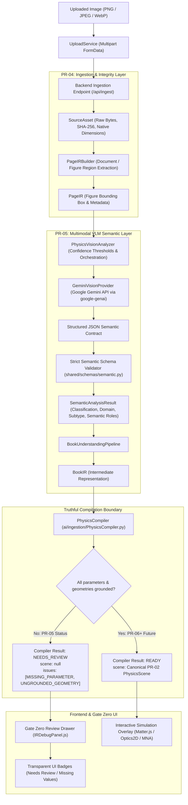

# AugmentedPhysics v2 — Research & Engineering Progress Report
## Milestones PR-04 & PR-05: Real-File Ingestion, Gate Zero Anti-Fabrication & Multimodal VLM Semantic Understanding

**Project:** AugmentedPhysics v2 (AI-Enhanced Interactive Physics Textbook Platform)  
**Author:** Research & Engineering Team  
**Date:** September 2026  
**Target Audience:** Academic Supervisor & Project Stakeholders  
**Repository Branch:** `main` (Merged PR-04 & PR-05)  
**Current Commit:** [`a989643`](https://github.com/rahi-sadat/AI-Enhanced-Interactive-Physics-Textbook/commit/a989643)  

---

## Executive Summary (2-Minute Overview)

Traditional attempts to turn textbook figures into interactive simulations suffer from a critical flaw: **simulation fabrication**. If a student or teacher uploads a diagram, existing systems often guess missing physics parameters (e.g., arbitrarily assuming gravity $g = 9.81\,\text{m/s}^2$, mass $m = 2\,\text{kg}$, or focal length $f = 20\,\text{cm}$) or classify diagrams based on flimsy cues like file names (`circuit.png`). In the worst cases, uploading an irrelevant landscape photo would synthesize a fake swinging pendulum because the system forced a simulation to run at all costs.

In **PR-04** and **PR-05**, we addressed this foundational challenge by engineering a **truthful, non-fabricating, end-to-end ingestion and semantic understanding pipeline**:

1. **PR-04 (Real-File Ingestion & Gate Zero Anti-Fabrication)**:
   - Uploading is now governed strictly by **cryptographic raw byte hashing (SHA-256)** and image decoding. Filename and URL heuristics are 100% eliminated.
   - Introduced **Canonical Intermediate Representations** (`SourceAsset` $\to$ `PageIR` $\to$ `BookIR`).
   - Implemented the **Gate Zero Invariant**: if physical values or visual geometries are unverified or absent, `PhysicsCompiler` truthfully refuses to compile a simulation (`scene: null`, `status: NEEDS_REVIEW`), surfacing clear diagnostics in the browser.

2. **PR-05 (Multimodal VLM Semantic Understanding & Strict Invariants)**:
   - Integrated state-of-the-art **Multimodal Vision-Language Models (Google Gemini)** via the official SDK with structured JSON contracts.
   - **Strict Semantic Separation**: The VLM acts *purely as a semantic classifier* (identifying the domain, subtype, and semantic roles like pivot, bob, lens, resistor). The VLM is **strictly forbidden from fabricating numerical parameters or authoritative visual coordinates**.
   - **Conservative Confidence Policy**: Reserved $1.0$ confidence exclusively for verified ground truth. Concept scores are capped below $1.0$, and the overall score is strictly computed as the hierarchical minimum across stages:
     $$\text{overall} = \min(\text{isPhysics}, \text{domain}, \text{subtype})$$
   - **Asynchronous Loop Offloading**: Heavy synchronous VLM operations are offloaded from FastAPI’s event loop via worker threads, keeping the server responsive under load.

**Test & Verification Status:**  
- **73 / 73 Python backend tests passing** (unit, schema, pipeline, and integration).  
- **241 / 241 Frontend browser & engine tests passing**.  
- Verified with real textbook diagrams (mechanics, optics, circuits) and negative controls (unsupported physics, non-physics photos).

---

## 1. Problem Statement: Why Was This Architecture Necessary?

Before PR-04, the system lacked a rigorous ingestion boundary:
- **Heuristic Shortcut Vulnerability**: A file named `optics_lens.png` could trigger an optics simulation based on its name alone, without inspecting the actual image contents.
- **Silent Parameter Fabrication**: If the diagram did not specify the focal length, the system would silently substitute $20\,\text{cm}$ and generate a simulation. While visually appealing, this is **academically dishonest**; students are misled into believing the simulation reflects the textbook figure when it is merely running hardcoded default assumptions.
- **Unbounded VLM Hallucination**: Off-the-shelf generative AI models will readily hallucinate exact pixel coordinates or plausible-sounding physical numbers ($m=1\,\text{kg}$, $R=10\,\Omega$) when prompted.

### Our Core Scientific Principle: The Anti-Fabrication Invariant
> *"An interactive physics simulation must be grounded in verified perceptual evidence. Missing evidence must produce an honest review request (`NEEDS_REVIEW`), never a fabricated running simulation."*

---

## 2. End-to-End System Architecture

The following diagram illustrates how an uploaded diagram transitions through the PR-04 and PR-05 pipeline without fabricating physics:



---

## 3. PR-04 Detailed Breakdown: Honest Ingestion & Data Pipeline

### 3.1 Data Contracts: SourceAsset $\to$ PageIR $\to$ BookIR

PR-04 introduced three strictly typed, canonical data representations in [`shared/schemas/ingestion.py`](file:///d:/AugmentedPhysics/shared/schemas/ingestion.py):

| Schema | Purpose | Key Attributes | Anti-Fabrication Guarantee |
| :--- | :--- | :--- | :--- |
| **`SourceAsset`** | Encapsulates the immutable uploaded file. | `id`, `storage_path`, `sha256`, `mime_type`, `width_px`, `height_px` | Cryptographic SHA-256 prevents duplicate spoofing. Filename is ignored. |
| **`PageIR`** | Encapsulates document page and figure regions. | `figures: [FigureRegion]`, `dimensions`, `coordinate_space: "source_px"` | Normalizes all coordinates to natural image pixels. |
| **`BookIR`** | Encapsulates semantic understanding of the physics figure. | `domain`, `subtype`, `entities: [BookEntity]`, `parameters: {}`, `status` | Parameters and geometry start strictly empty (`{}`) and `null`. |

### 3.2 Status State Machine
A `BookIR` diagram moves through an explicit state machine:
- **`UNRESOLVED`**: Non-physics images (e.g. photos of buildings) or unclassifiable content.
- **`UNSUPPORTED`**: Recognized physics diagrams for which no simulation engine currently exists (e.g. quantum mechanics, wave interference).
- **`NEEDS_REVIEW`**: Supported physics (e.g. pendulum, convex lens, DC circuit) where semantic roles are identified, but numerical values or visual coordinates require verification.
- **`READY_TO_COMPILE`**: Fully verified evidence with zero missing parameters (reserved for PR-06/07).

### 3.3 Gate Zero UI Review Drawer
Instead of failing silently or crashing, the frontend receives the honest payload and displays the **Gate Zero Review Panel** ([`IRDebugPanel.js`](file:///d:/AugmentedPhysics/apps/web/src/features/simulations/core/IRDebugPanel.js)). Teachers and students can inspect:
- The exact cryptographic hash of the asset.
- The identified classification and domain.
- The specific missing parameters required before simulation compilation can proceed.

---

## 4. PR-05 Detailed Breakdown: Multimodal VLM Semantic Understanding

PR-05 integrates multimodal foundation models (Google Gemini) to examine raw image bytes and interpret the physical scene.

### 4.1 Strict Architectural Boundary: Semantic Classification vs. Metric Grounding

To prevent generative hallucinations, PR-05 established a strict non-negotiable boundary:

```
VLM Output Boundary (PR-05)            Classical CV/OCR Boundary (PR-06+)
-----------------------------------    ----------------------------------
Classification: supported     [OK]     Authoritative Coordinates:    [PR-06]
Native Boolean isPhysics:     [OK]     position_source_px: null      [PR-06]
Domain: mechanics/optics/...  [OK]     geometry (points, arcs): null [PR-06]
Subtype: pendulum/lens/...    [OK]     Numerical Parameters: {}      [PR-06]
Semantic Roles: pivot, bob    [OK]     Physical Units:               [PR-06]
Coarse Bounding Box (approx)  [OK]*    Parameter Binding:            [PR-06]
```
*\* Coarse bounding boxes from the VLM are strictly quarantined in `attributes["vlmApproxBBox"]` with `vlmLocalizationVerified: False` and are NEVER treated as authoritative simulation coordinates.*

### 4.2 Conservative Confidence Policy & Hierarchical Minimum
A common issue in AI pipelines is the model claiming $1.0$ (100%) certainty for unverified predictions. We instituted a **conservative confidence policy**:

1. **$1.0$ is Strictly Prohibited for VLM Output**:
   - Reserving $1.0$ exclusively for author-confirmed ground truth and verified benchmark datasets.
   - Core concept confidences are capped:
     $$\text{isPhysics} \le 0.99, \quad \text{domain} \le 0.98, \quad \text{subtype} \le 0.96$$
   - Sub-objects (entities, relationships, visible labels, candidates) are capped at $\le 0.95$.
2. **Deterministic Hierarchical Minimum for `overall` Confidence**:
   The composite confidence score is not arbitrary; for supported physics, it is strictly computed as the weakest link among active conceptual stages:
   $$\text{overall} = \min(\text{isPhysics}, \text{domain}, \text{subtype})$$
   *Example*: If Gemini reports $\text{isPhysics}=1.0$, $\text{domain}=1.0$, $\text{subtype}=1.0$, the clipped values are $0.99, 0.98, 0.96$, resulting in:
   $$\text{overall} = \min(0.99, 0.98, 0.96) = 0.96$$
3. **Raw Signal Auditability**:
   The model's original unaltered output is faithfully preserved under `rawProvider` for verification and research logs:
   ```json
   "confidence": {
     "isPhysics": 0.99,
     "domain": 0.98,
     "subtype": 0.96,
     "overall": 0.96,
     "rawProvider": {
       "isPhysics": 1.0,
       "domain": 1.0,
       "subtype": 1.0,
       "overall": 1.0
     }
   }
   ```

### 4.3 Enriched Semantic Roles by Subtype
PR-05 enriches the semantic ontology across all supported domains:
- **Pendulum (Mechanics)**: `pivot`, `bob`, `string`, `rod`, `support_ceiling`, `angle_marker`, `equilibrium_position`, `force_vector`, `vertical_reference`, `extreme_position`.
- **Projectile (Mechanics)**: `launch_platform`, `projectile`, `target`, `trajectory_path`, `angle_marker`, `ground_surface`.
- **Geometric Optics**: `lens`, `mirror`, `optical_axis`, `focal_point`, `object_source`, `image_probe`, `refracting_interface`, `prism_body`.
- **Circuits**: `voltage_source`, `resistor`, `switch`, `capacitor`, `inductor`, `wire`, `ground`, `junction`, `ammeter`, `voltmeter`.

### 4.4 Real-World Execution Telemetry
Every analysis call tracks provenance and performance metrics:
- `latency_ms`: High-resolution call duration ($6489\,\text{ms}$).
- `fallback_used`: Explicit boolean indicating whether free-tier rate limits triggered a fallback model (e.g. `gemini-3.8-flash` $\to$ `gemini-3.1-flash-lite`).
- `cache_hit`: Explicit boolean indicating whether result was served from cache (`false`).

---

## 5. Verification & Test Suite Summary

The changes in PR-04 and PR-05 were verified using a dual-layer test suite spanning backend unit tests, live API acceptance tests, and frontend integration tests.

### 5.1 Python Test Suite (73 Tests — 100% Passing)
```
tests/unit/test_mna.py ................................ [PASS] (Circuit MNA math)
tests/unit/test_pendulum_geometry.py .................. [PASS] (Sub-pixel coordinate checks)
tests/unit/test_pr04_ingestion.py ..................... [PASS] (SourceAsset & PageIR contracts)
tests/unit/test_pr05_book_understanding.py ............ [PASS] (BookIR pipeline mapping)
tests/unit/test_pr05_semantic_schemas.py .............. [PASS] (Strict validation, hierarchical min)
tests/unit/test_pr05_vlm_analyzer.py .................. [PASS] (Analyzer thresholds & candidates)
tests/unit/test_strict_analysis.py .................... [PASS] (Zero-fabrication invariant checks)
tests/unit/test_topology.py ........................... [PASS] (Union-Find circuit nodes)
tests/unit/test_value_parser.py ....................... [PASS] (SI units & multiplier prefixes)
tests/integration/test_circuit_images.py .............. [PASS] (Circuit schematic fixtures)
tests/integration/test_optics_precision.py ............ [PASS] (Optics ray tracer precision)
tests/integration/test_pr04_api_upload.py ............. [PASS] (FastAPI multipart ingestion)
tests/integration/test_pr05_pipeline.py ............... [PASS] (End-to-end VLM ingestion pipeline)
======================= 73 passed in 15.84s =======================
```

### 5.2 Live Multimodal VLM Acceptance Test (`test_pr05_live_gemini.py`)
Tested against real textbook diagrams and negative controls using live Gemini:
1. **Pendulum diagram (randomized filename)** $\to$ Correctly classified as `mechanics / pendulum`, `BookIR: NEEDS_REVIEW`, `scene: null`.
2. **Convex Lens diagram** $\to$ Correctly classified as `optics / thin_lens`, `BookIR: NEEDS_REVIEW`, `scene: null`.
3. **Resistor circuit** $\to$ Correctly classified as `circuits / dc_linear`, `BookIR: NEEDS_REVIEW`, `scene: null`.
4. **Wave Interference diagram** $\to$ Correctly classified as `unsupported_physics`, `domain: null`, `subtype: null`, `BookIR: UNSUPPORTED`, `scene: null`.
5. **Non-physics photograph** $\to$ Correctly classified as `non_physics`, `domain: null`, `subtype: null`, `BookIR: UNRESOLVED`, `scene: null`.

### 5.3 Frontend Browser Test Suite (241 Tests — 100% Passing)
- Direct manipulation of simulation handles (pendulums, optical sliders, circuit toggles).
- Dynamic aspect-ratio letterbox compensation in `CoordinateMapper`.
- Gate Zero review drawer UI contracts.

---

## 6. What Was Changed & What Files Were Touched?

The complete Git diff across PR-04 and PR-05 comprises **25 core files** (3,911 lines added):

| File Path | Functional Role |
| :--- | :--- |
| [`shared/schemas/ingestion.py`](file:///d:/AugmentedPhysics/shared/schemas/ingestion.py) | Canonical data models: `SourceAsset`, `PageIR`, `BookIR`, `BookEntity`, `PhysicalValue`. |
| [`shared/schemas/semantic.py`](file:///d:/AugmentedPhysics/shared/schemas/semantic.py) | Semantic schema contracts: `SemanticConfidence`, `SemanticEntity`, hierarchical overall calculation, cap validations. |
| [`ai/ingestion/vision/gemini_provider.py`](file:///d:/AugmentedPhysics/ai/ingestion/vision/gemini_provider.py) | Google GenAI SDK integration, model fallback logic, latency measurement, structured prompt. |
| [`ai/ingestion/vision/analyzer.py`](file:///d:/AugmentedPhysics/ai/ingestion/vision/analyzer.py) | Confidence threshold filter downgrading uncertain classifications to `unknown`. |
| [`ai/ingestion/vision/mock_provider.py`](file:///d:/AugmentedPhysics/ai/ingestion/vision/mock_provider.py) | Deterministic mock provider for fast offline unit testing (zero network dependencies). |
| [`ai/ingestion/BookUnderstandingPipeline.py`](file:///d:/AugmentedPhysics/ai/ingestion/BookUnderstandingPipeline.py) | Bridge mapping validated VLM predictions into canonical `BookIR` instances. |
| [`ai/ingestion/PhysicsCompiler.py`](file:///d:/AugmentedPhysics/ai/ingestion/PhysicsCompiler.py) | Enforces the Gate Zero anti-fabrication boundary; returns `scene: null` when parameters are ungrounded. |
| [`apps/api/main.py`](file:///d:/AugmentedPhysics/apps/api/main.py) | REST endpoint (`/api/ingest`), file storage, asynchronous thread offloading (`asyncio.to_thread`). |
| [`apps/web/src/features/simulations/core/IRDebugPanel.js`](file:///d:/AugmentedPhysics/apps/web/src/features/simulations/core/IRDebugPanel.js) | Gate Zero frontend drawer presenting raw IR JSON, diagnostics, and missing parameter badges. |
| [`tests/acceptance/test_pr05_live_gemini.py`](file:///d:/AugmentedPhysics/tests/acceptance/test_pr05_live_gemini.py) | Live acceptance test with strict assertions on classification, confidence caps, and non-fabrication. |
| [`PROJECT_CONTEXT.md`](file:///d:/AugmentedPhysics/PROJECT_CONTEXT.md) & [`AGENTS.md`](file:///d:/AugmentedPhysics/AGENTS.md) | Architectural documentation, operational guidelines, and PR milestone registry. |

---

## 7. Next Steps: Roadmap to PR-06 and PR-07

Now that the semantic foundation (PR-05) is firmly established and merged into `main`, the upcoming milestones will bridge semantic understanding to running simulations:

```
[PR-04 Ingestion]  -->  [PR-05 Semantic VLM]  -->  [PR-06 CV & OCR Grounding]  -->  [PR-07 Auto Bootstrap]
     Done                     Done                        NEXT UP                         PLANNED
  (Real Bytes,            (Classification,            (SAM 2 Segmenter,             (Executable PR-02
  Anti-Fabrication)       Semantic Roles,              Tesseract OCR,                PhysicsScene with
                          Hierarchical Min)            Spatial-Semantic Binding)     100% Parameter Provenance)
```

1. **PR-06 (Classical CV & OCR Grounding)**:
   - Use Segment Anything Model (SAM 2), Hough transforms, and OpenCV to ground authoritative visual coordinates (`position_source_px`).
   - Use Tesseract / Document Intelligence OCR to extract physical parameter values (e.g. $L = 1\,\text{m}$, $f = 15\,\text{cm}$, $R_1 = 10\,\Omega$).
   - Spatially bind OCR values to CV-detected components.
2. **PR-07 (End-to-End Bootstrap)**:
   - Merge PR-05 semantics, PR-06 geometry, and PR-06 parameters into `BookIR(status=READY_TO_COMPILE)`.
   - `PhysicsCompiler` produces a fully runnable PR-02 `PhysicsScene`, bootstrapping interactive simulations over textbook diagrams with zero human authoring.

---

*Report prepared and compiled from commit [`a989643`](https://github.com/rahi-sadat/AI-Enhanced-Interactive-Physics-Textbook/commit/a989643) on branch `main`.*
